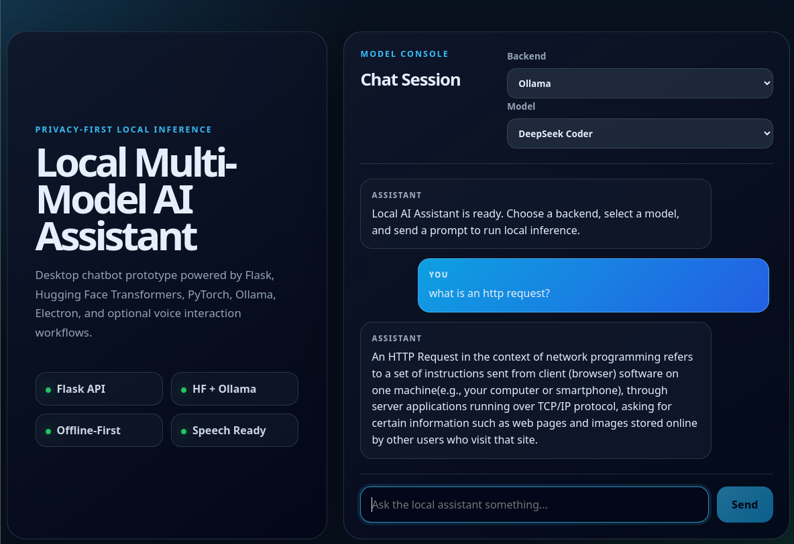

# Local Multi-Model AI Assistant

A privacy-first desktop AI assistant built with **Electron**, **React**, **Flask**, **Hugging Face Transformers**, **PyTorch**, **Ollama**, and an optional **openWakeWord** local voice client.

The application runs local language models on your own hardware without sending conversation data to external cloud LLM APIs, allowing users to switch dynamically between in-process Hugging Face models (Seq2Seq and Causal LMs) and locally hosted Ollama models.

---

## Screenshot



---

## Key Features

- **Dual Local Inference Backends** (`ai_service.py`):
  - **Hugging Face Transformers (In-Process PyTorch)**: Supports both encoder-decoder (`google/flan-t5-small`) and decoder-only causal models (`distilgpt2`, `TinyLlama-1.1B`, `microsoft/phi-2`, `gpt2`) with lazy in-memory weight caching (`model_cache`), `model.eval()`, and `torch.no_grad()` inference.
  - **Ollama REST Adapter**: Connects to a local Ollama daemon (`http://127.0.0.1:11434/api/generate`) for quantized GGUF models (`mistral:latest`, `deepseek-coder:latest`).
- **Desktop + Web Interface** (`main.js`, `ui/src/App.js`):
  - Context-isolated Electron desktop window wrapping a responsive React chat interface with live backend/model switching.
- **Privacy-First Wake-Word Voice Loop** (`wake.py`):
  - Continuously monitors 16 kHz microphone PCM frames completely offline using `openWakeWord` (`.onnx`/`.tflite`), only capturing a spoken command and speaking the reply via `pyttsx3` after the wake word exceeds the confidence threshold.

---

## Architecture

```text
+--------------------------------------------------+
| Electron Desktop Shell (main.js)                 |
|  └── React Chat UI (ui/src/App.js)               |
+--------------------------------------------------+
                        │
                        │ POST http://127.0.0.1:5001/generate
                        │ { message, backend, model }
                        ▼
+--------------------------------------------------+      +------------------------------------+
| Flask Inference Service (ai_service.py)          |◄─────| Optional Voice Client (wake.py)    |
|  ├── Hugging Face Pipeline (PyTorch + Cache)     |      | openWakeWord -> STT -> pyttsx3 TTS |
|  └── Ollama Adapter (127.0.0.1:11434)            |      +------------------------------------+
+--------------------------------------------------+
```

---

## Project Structure

```text
local-ai-chatbot/
├── ai_service.py            # Flask API for Hugging Face & Ollama local inference
├── wake.py                  # Optional openWakeWord + SpeechRecognition + pyttsx3 voice client
├── main.js                  # Electron desktop window entrypoint (context-isolated)
├── preload.js               # Electron preload script
├── run_chatbot.sh           # Convenience launcher for Flask + Electron/React
├── requirements.txt         # Python dependencies
├── tests/
│   └── test_ai_service.py   # Mock-isolated Python unit tests for Flask & voice client
└── ui/
    ├── package.json         # React frontend dependencies
    └── src/
        ├── App.js           # Multi-backend chat interface
        ├── App.css          # Dark glassmorphic UI styles
        └── App.test.js      # React Testing Library component tests
```

---

## Quick Start

### 1. Python Backend Setup

```bash
git clone https://github.com/lupenox/local-ai-chatbot.git
cd local-ai-chatbot
python -m venv .venv
source .venv/bin/activate
pip install -r requirements.txt
cp .env.example .env
```

Start the Flask inference server on port `5001`:

```bash
python ai_service.py
```

### 2. Electron & React UI Setup

In a second terminal:

```bash
npm install
cd ui && npm install && cd ..
npm start
```

Or launch both the Python backend and desktop UI together with:

```bash
./run_chatbot.sh
```

### 3. Example API Request

```bash
curl -X POST http://127.0.0.1:5001/generate \
  -H "Content-Type: application/json" \
  -d '{"message": "Explain recursion in one sentence.", "backend": "huggingface", "model": "flan-t5"}'
```

---

## Running Tests

### Python Backend & Voice Tests
Runs with in-memory mocks (no model downloads, GPU, or microphone required):

```bash
python -m unittest discover -s tests -v
```

### React Frontend Tests & Production Build

```bash
cd ui
CI=true npm test -- --watchAll=false
npm run build
```

---

## Architecture & Interview Defense Guide

### 1. Why Separate the Electron/React Frontend from a Python Flask Service?
- **Ecosystem Fit**: JavaScript/React (`ui/src/App.js`) + Electron (`main.js`) provides a cross-platform desktop UI, while Python has first-class support for PyTorch, Hugging Face `transformers`, and `openWakeWord`.
- **Decoupled Local IPC**: Communicating over loopback HTTP (`127.0.0.1:5001/generate`) allows the same inference backend to serve the React desktop UI, the `wake.py` voice assistant, and `curl`/CLI scripts simultaneously.

### 2. How Does `ai_service.py` Handle Different Model Architectures (Seq2Seq vs. Causal LM)?
- **Architecture Detection (`is_seq2seq_model`)**: Encoder-decoder models like `google/flan-t5-small` require `AutoModelForSeq2SeqLM`, whereas decoder-only autoregressive models (`gpt2`, `distilgpt2`, `TinyLlama`, `phi-2`) require `AutoModelForCausalLM`.
- **Prompt Token Slicing**: When calling `model.generate(**inputs)`, Seq2Seq models output only the newly generated target tokens, whereas Causal LMs output the input prompt tokens followed by the newly generated tokens. `generate_with_huggingface()` slices `output_tokens[0][input_length:]` for Causal LMs so the API returns only the assistant's completion instead of echoing the user's prompt.
- **Inference Hygiene**: Models are loaded once into `model_cache` with `low_cpu_mem_usage=True`, placed into `model.eval()` mode (disabling dropout), and executed inside `with torch.no_grad():` to avoid allocating autograd graphs in RAM/VRAM.

### 3. Why Support Both Hugging Face Transformers and Ollama?
- **Hugging Face Transformers** gives direct programmatic control over PyTorch tensors, tokenizers, and small CPU-friendly models (`flan-t5-small`, `distilgpt2`) with zero external daemon setup.
- **Ollama** excels at running larger 7B+ quantized GGUF models (`mistral:latest`, `deepseek-coder:latest`) via `llama.cpp` under the hood. Supporting both behind a unified `/generate` contract (`{message, backend, model}`) lets the user trade off footprint vs. model capability at runtime.

### 4. How Does the Wake-Word Pipeline (`wake.py`) Preserve Privacy?
- Continuously streaming raw microphone audio to a cloud STT API is expensive and invasive.
- `wake.py` reads 16 kHz 16-bit mono PCM frames (`1280` samples / `80 ms` per frame) via `PyAudio` and runs `openWakeWord` locally on-device. Speech recognition (`listen_for_command`) is only triggered *after* the local wake-word score exceeds `WAKEWORD_THRESHOLD`.

### 5. What Electron Security Practices Are Used in `main.js`?
- `BrowserWindow` is configured with `contextIsolation: true` and `nodeIntegration: false`, ensuring the renderer process cannot execute arbitrary Node.js/OS primitives if untrusted text is rendered in the chat window.
